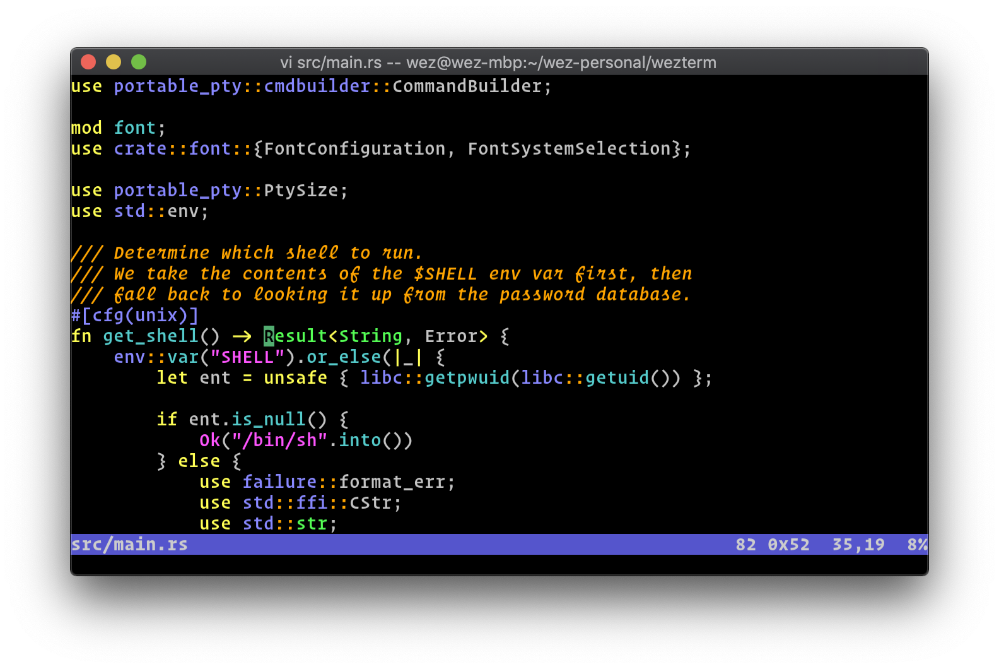

# Wez's Terminal

 *A GPU-accelerated cross-platform terminal emulator and multiplexer written by <a href="https://github.com/wez">@wez</a> and implemented in <a href="https://www.rust-lang.org/">Rust</a>*

User facing docs and guide at: https://wezterm.org/



*Screenshot of wezterm on macOS, running vim*

## About this fork

This is a personal fork of [wezterm/wezterm](https://github.com/wezterm/wezterm)
that is built for Windows. It adds the following on top of upstream:

### Wider dividers between panes

By default the divider between panes is a single cell wide, with the split
line drawn through its middle, so the text of adjacent panes ends up half a
cell away from the line. Two options make the dividers wider/taller:

```lua
config.pane_divider_cols = 3 -- width of the divider between left/right panes, in cells
config.pane_divider_rows = 2 -- height of the divider between top/bottom panes, in rows
```

* Both default to `1` (the upstream behavior) and accept values from `1` to `8`.
* The split line is drawn through the middle of the divider, and the whole
  divider can be dragged with the mouse to resize the panes.
* Changing the values and reloading the configuration re-arranges the panes
  of the open tabs, keeping their proportions.
* With multiplexer domains (`wezterm connect`, unix and ssh domains) the
  panes are laid out by the mux server, which must use the same values.

See [pane_divider_cols](docs/config/lua/config/pane_divider_cols.md) and
[pane_divider_rows](docs/config/lua/config/pane_divider_rows.md).

### Highlighting the active pane

```lua
config.active_pane_split_color = "#7aa2f7" -- outline the active pane in this color
config.pane_divider_line_width = "2px"      -- thickness of the split lines; 0 hides them
```

The parts of the split lines that border the active pane are drawn in
`active_pane_split_color`; it is not set by default. See
[active_pane_split_color](docs/config/lua/config/active_pane_split_color.md)
and [pane_divider_line_width](docs/config/lua/config/pane_divider_line_width.md).

### Toast notifications

```lua
config.notification_handling = "SuppressFromFocusedPane"
config.toast_notification_duration = "Short" -- Windows: about 5 seconds rather than 25
config.toast_notification_silent = true      -- Windows: no notification sound
config.toast_notification_click_switches_workspace = true -- a click may switch workspace
config.win32_focus_alt_key_workaround = "WhenNeeded" -- don't always simulate ALT to raise a window

-- decide how the notifications from panes look without rebuilding wezterm
wezterm.on("format-toast-notification", function(window, pane, notification)
  return { attribution = pane:get_title(), silent = true }
end)
```

* On Windows, clicking on a notification that was generated by a pane
  (`OSC 9` or `OSC 777`) brings its window to the front and activates that
  pane and its tab. If the pane belongs to a workspace that isn't the
  active one, the click only switches to that workspace when
  `toast_notification_click_switches_workspace` is enabled.
* On Windows, a pane has at most one notification at a time: a new one
  replaces the earlier one, and it is removed when you move to that pane or
  close it.
* The `format-toast-notification` event can change the heading and the text
  of such a notification, add a line that says where it came from, make it
  silent, change its duration, or prevent it from being shown.
* The `SuppressFromFocused*` values of `notification_handling` only suppress
  the notification while the wezterm window that shows the pane has the
  keyboard focus; upstream also suppresses it after you have switched to a
  different application.
* Focusing a minimized window on Windows (`window:focus()`, `ActivateWindow`,
  `ActivateWindowRelative` or a click on a notification) restores it.

See [format-toast-notification](docs/config/lua/window-events/format-toast-notification.md),
[toast_notification_duration](docs/config/lua/config/toast_notification_duration.md),
[toast_notification_silent](docs/config/lua/config/toast_notification_silent.md),
[toast_notification_click_switches_workspace](docs/config/lua/config/toast_notification_click_switches_workspace.md),
[win32_focus_alt_key_workaround](docs/config/lua/config/win32_focus_alt_key_workaround.md)
and [notification_handling](docs/config/lua/config/notification_handling.md).

### Command macros

`require("macros")` provides named macros: sequences of commands that are
typed into a pane, optionally waiting for output in between. Because they
type into the pane, they also work on a remote host after `ssh`:

```lua
local macros = require("macros")
macros.define("web01-logs", {
  description = "Connect to web01 and follow the application log",
  steps = {
    "ssh web01",
    { wait_for = macros.PROMPT, timeout = 30 }, -- wait for the remote prompt
    "cd /srv/app && tail -f log/app.log",
  },
})
config.keys = {
  { key = "m", mods = "ALT", action = macros.action.select() },       -- pick and run a macro
  { key = "b", mods = "ALT", action = macros.action.bind_to_pane() }, -- bind one to the pane
}
```

Macros can be run from key bindings, a fuzzy selector or the command
palette, cancelled, and bound to a pane or a tab: the bundled resurrect
saves the binding and runs the macro again when it restores the pane
(asking first by default), so a pane that was connected to a server
reconnects to it. See [lua-api-crates/macros/README.md](lua-api-crates/macros/README.md).

### Built-in session saving (resurrect)

The [resurrect.wezterm](https://github.com/MLFlexer/resurrect.wezterm) plugin,
which saves and restores windows, tabs, panes and their text, is compiled into
wezterm, so it works without downloading anything:

```lua
local resurrect = require("resurrect")
```

Do not also load it with `wezterm.plugin.require`. Compared to the upstream
plugin, the bundled version:

* has no runtime dependency on the third party `dev.wezterm` plugin;
* doesn't spawn helper processes (`mkdir`, VBS scripts via `wscript.exe`,
  `find`), except for the optional encryption with `age`/`rage`/`gpg`;
* saves the state in `%LOCALAPPDATA%\wezterm\resurrect\` on Windows
  (`<wezterm data dir>/resurrect/` elsewhere);
* works with the wider pane dividers described above;
* saves the [macros](lua-api-crates/macros/README.md) bound to panes and
  tabs, and runs them when it restores them.

The saved state contains the text of the panes in plain text unless
encryption is enabled. See
[lua-api-crates/resurrect/README.md](lua-api-crates/resurrect/README.md)
for a complete configuration example (key bindings to save and restore,
periodic saving, restoring the last session on startup) and the list of
changes.

### Plugins must be allowed

`wezterm.plugin.require` downloads a plugin from the network and runs it with
wezterm's rights, and a plugin can download further plugins. This build only
loads plugins that are listed first:

```lua
wezterm.plugin.allow({ "https://github.com/owner/repo" }) -- or "*" for any plugin
local plugin = wezterm.plugin.require("https://github.com/owner/repo")
```

The list can't be changed after the first `wezterm.plugin.require`, so a
plugin can't allow itself to load more code. See
[wezterm.plugin.allow](docs/config/lua/wezterm.plugin/allow.md).

### Getting a build

Download the latest build from the
[Releases](https://github.com/dbevdev/wezterm/releases/latest) page: every
change merged into `main` is built for Windows and published as a release,
with the installer (`WezTerm-*-setup.exe`), a portable zip
(`WezTerm-windows-*.zip`; you only need one of the two) and their SHA-256
checksums. A new release can also be published by hand by running the
`windows_continuous` workflow on the Actions page.

wezterm checks for updates in this fork's releases (not upstream's, which
lack these features) and shows a notification when a newer one is
available; `config.check_for_updates = false` turns that off.

Every pull request is also built and tested by the `windows` workflow; its
installer is available as the `windows` artifact of the run on the
[Actions](https://github.com/dbevdev/wezterm/actions) page (you need to be
signed in to GitHub).

To install, close all wezterm windows (and `wezterm-mux-server.exe`, if you
use multiplexer domains) and run the installer. It is not code signed, so
Windows SmartScreen will warn about it: choose *More info → Run anyway*. The
installer replaces an existing installation of the official wezterm; to go
back, install the official release over it. The portable zip can be unpacked
anywhere and run side by side with an installed version.

The other upstream workflows (Linux, macOS, Nix, formatting, docs) can be
started manually from the Actions page.

## Installation

https://wezterm.org/installation

## Getting help

This is a spare time project, so please bear with me.  There are a couple of channels for support:

* You can use the [GitHub issue tracker](https://github.com/wezterm/wezterm/issues) to see if someone else has a similar issue, or to file a new one.
* Start or join a thread in our [GitHub Discussions](https://github.com/wezterm/wezterm/discussions); if you have general
  questions or want to chat with other wezterm users, you're welcome here!
* There is a [Matrix room via Element.io](https://matrix.to/#/#wezterm:matrix.org)
  for (potentially!) real time discussions.

The GitHub Discussions and Element/Gitter rooms are better suited for questions
than bug reports, but don't be afraid to use whichever you are most comfortable
using and we'll work it out.

## Supporting the Project

If you use and like WezTerm, please consider sponsoring it: your support helps
to cover the fees required to maintain the project and to validate the time
spent working on it!

[Read more about sponsoring](https://wezterm.org/sponsor.html).

* [](https://github.com/sponsors/wez)
* [Patreon](https://patreon.com/WezFurlong)
* [Ko-Fi](https://ko-fi.com/wezfurlong)
* [Liberapay](https://liberapay.com/wez)
